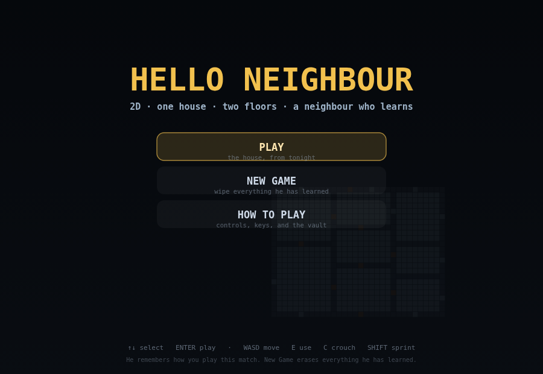
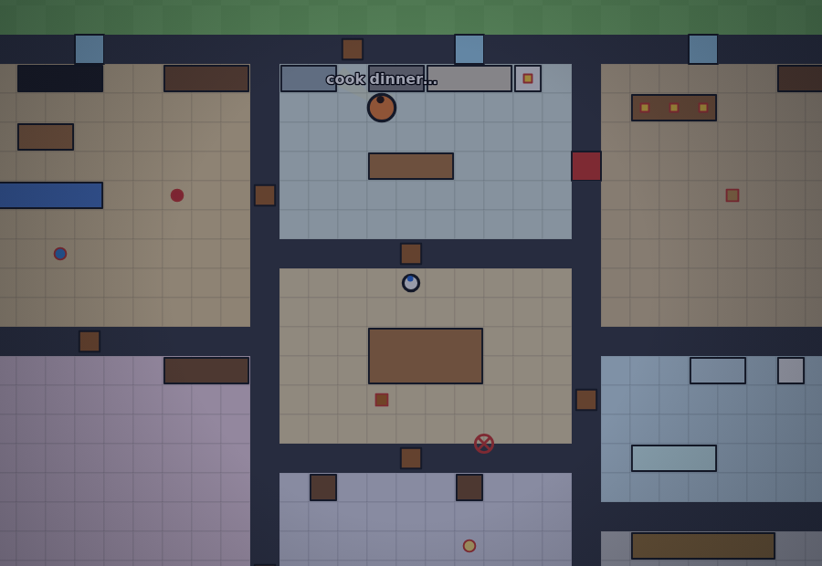
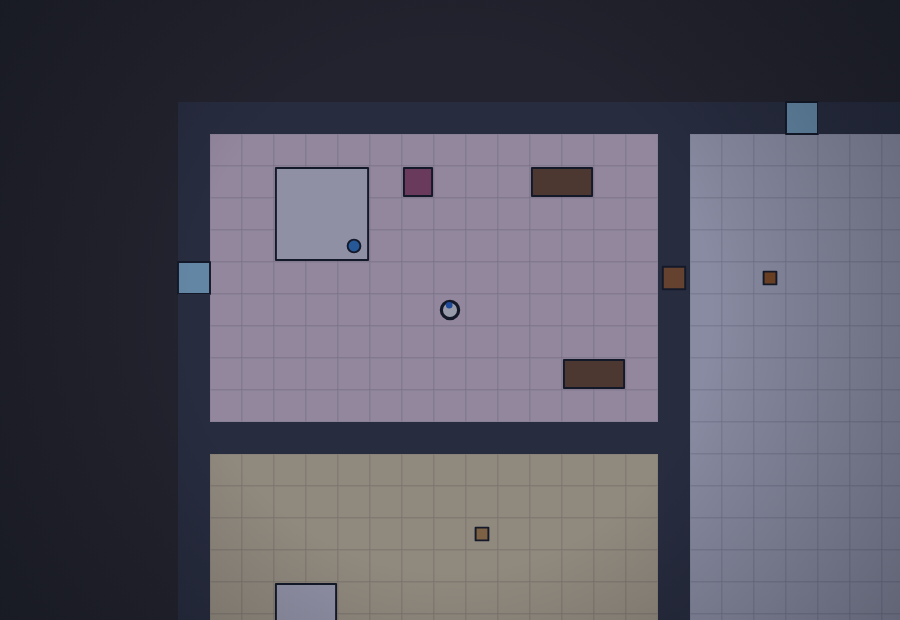
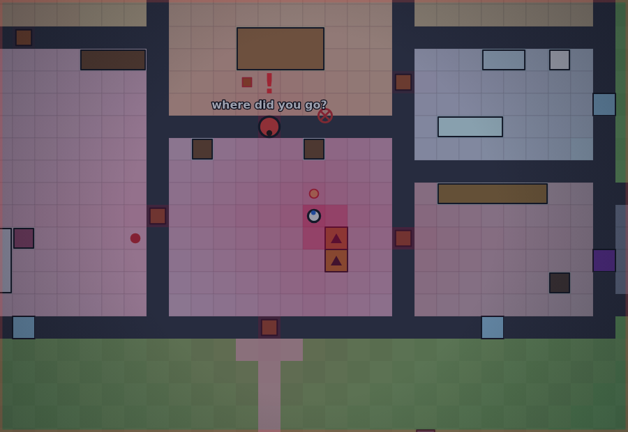
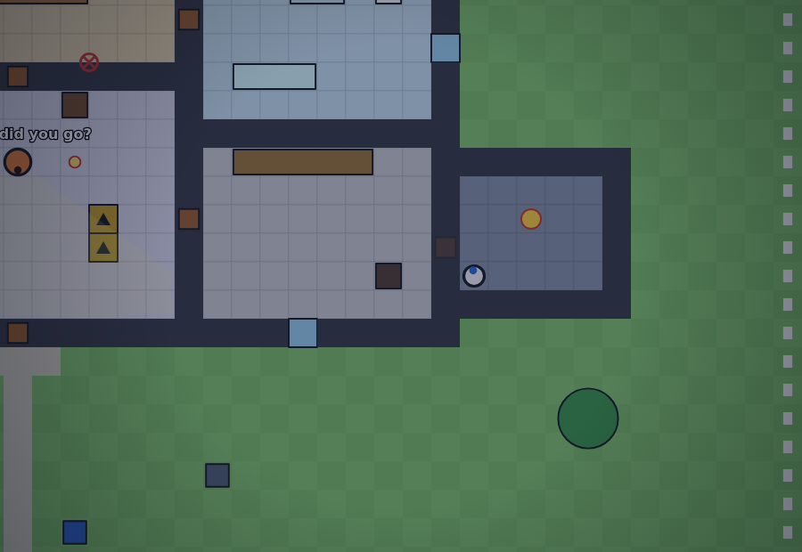

# Hello Neighbour 2D 🔦

A single-file browser stealth game. Break into **one fixed house**, out-think a
neighbour who **learns how you play**, and take what is locked in his vault.

The house is hand-built — same walls, same doors, same shed, same stairs every
match. The only thing that changes between matches is what he remembers.

Everything lives in **[`index.html`](index.html)** — no build step, no
dependencies, no external assets, no network. Open the file, press **Play**.



## What is in this build

| System | What it actually does |
| --- | --- |
| **One hand-built house** | The original ground floor, tile for tile, plus a second floor. No generator, no seeds, no retry-until-valid — the map in `index.html` is the map you play. |
| **Two floors** | Ground floor and upstairs, joined by a two-tile staircase in the foyer. He uses the stairs too, and losing him on the landing is how you get away. |
| **Flat, plain art** | Solid-colour tiles, coloured boxes for furniture, circles for people. No shading, no rugs, no light pools — the look from the first build. |
| **Keyring, not pockets** | The lockpick, the red key and the blue key live on a HUD keyring. They are never items, never in the bag, never throwable. |
| **Day / night** | The clock runs 42 real seconds per in-game hour. At night his sight drops 20% and the house goes blue. Crouching at night is nearly invisible; sprinting is not. |
| **A neighbour who learns** | Footstep triangulation, a real belief map he chases on, chokepoint ambushes, local cut-offs, tomato forensics, theft detection, re-locking, boarding, traps, cameras. Details below. |
| **Match-scoped memory** | Everything he learns belongs to one match. Continue keeps it, New Game wipes it. |



*Night. Crouched in the dining room while he cooks next door. The cone is his
actual field of view — cut by the walls, not decoration.*

## How to play

| Input | Action |
| --- | --- |
| **WASD / arrows** | Move |
| **Shift** | Sprint — fast, loud, and visible |
| **C** | Crouch — slow, silent, hard to see |
| **E** | Use: search, open, pick locks, take the stairs, climb windows, take the SECRET |
| **G** | Grab / set down a loose object |
| **Q** / **F** / **left-click** | Throw ahead / throw at the cursor |
| **H** | Hide (dark corners only) |
| **T** | Torch — light, but he sees you further |
| **M** | His belief map |
| **Wheel** | Zoom |
| **Esc / P** | Pause, with the panel of everything he knows |

**The route.** Get the **lockpick** from the shed → inside the house → pick the
**study** door → take the **blue key** from the desk → take the **red key** from
the kitchen fridge → unlock the **vault** in the workshop → take the SECRET.
The stairs in the foyer lead to the landing, two bedrooms, a bathroom and a
storage room — a way across the house that misses the rooms he watches.

The front door, the windows and the vault door are all real routes. Breaking a
window is loud; he will notice and board it up on a later attempt.

## The house



*Upstairs: master bedroom, spare room, landing, storage and the upstairs bath.*

The ground floor is unchanged from the first build: porch and path, living room,
kitchen, dining room, foyer, bedroom, study (locked), bathroom, workshop, the
vault behind its red door, and the shed in the west yard. The only addition is
the staircase in the foyer (tiles `U`/`N`) and the upstairs it leads to:

| Room | What it is for |
| --- | --- |
| **Landing** | The crossing. Reachable from the stairs, opens onto every upstairs room and back down. |
| **Master bedroom** | His bed. He sleeps here early in the night, and wakes if you are loud. |
| **Spare room** | The other bed; the hide spot when he is hunting downstairs. |
| **Storage** | Shelves and crates — a second place for search steps to end. |
| **Upstairs bath** | The far corner. A long way from the stairs, which is the point. |

The map is fixed and validated at boot: every room reachable from the gate, the
SECRET only behind the vault door, the study only behind the lock, no container
buried in furniture, no window with a wall behind it, and the stairs matching on
both floors.

## The neighbour

He is a small, honest simulation rather than a scripted chase.

### What he perceives

- **A real view cone** with occlusion: walls, closed doors and furniture block
  sight. The line-walk is corner-safe, so he cannot peek between two touching
  wall corners — the cone you see on screen is the cone he uses.
- **Stale sightings.** Alertness rises while he looks at you and decays when he
  does not; a glimpse in the dark does not instantly become a chase.
- **Hearing through geometry.** Noise radius is attenuated per wall crossed and
  almost mute between floors. Footsteps are quiet when crouched, loud when
  sprinting.
- **A rolling six-second noise buffer.** Three or more noises inside six seconds
  give him a direction *and* a speed, so he walks to the **predicted** position
  instead of the last one. "Following the sound…"
- **Night realism.** Sight range ×0.8 at night, ×1.5 with your torch on, ×1.15
  when you sprint, ×0.55 when you crouch, and a lit room helps him spot you.
- **Cameras**, once he has caught you twice, sweep a cone and radio him.

### The belief map — and how the chase uses it

The belief map is a **normalised probability** over both floors: every cell is
`P(you are here)`, the two floors together add up to 1. It is not a heat trail
that only grows.

- **Sighted** → the map collapses onto you, plus a short smear where you are
  heading (your velocity).
- **Lost** → it is anchored back onto the last sighting, and flows along
  walkable tiles toward **your objective** (`lockpick → red key → blue key →
  vault`), so it predicts the way you are going, not the way you came.
- **Rooms he has cleared** lose 80% of their mass. **Places he has caught you**
  gain ~90%. **The stairs** join the floors: mass crosses both ways.
- **The chase reads it every frame.** While he can see you the map sits on you.
  The moment he loses you, his target is the **weighted centroid of the
  likeliest area** he can actually reach — not the single hottest cell. If he
  lost you at the stairwell, he assumes you took the stairs and climbs.

Press **M** in game to see it.



*Press **M**: the red wash is his belief about where you are. The hot core is
where he last had you; the rest is where you are likely to be going.*

### The chase

- **One target, held.** He re-picks a chase target at most every 0.45 s, and
  only when the new spot is more than 1.6 tiles from the old one. That is what
  stops the twitch-left-twitch-right that made him look confused.
- **Direct or pathing, with hysteresis.** Close and clear, he runs straight at
  you; past 7.6 tiles he drops back to pathing. He cannot flip between the two
  every frame.
- **Local cut-offs only.** If he can see you and a point on your route to the
  objective is genuinely shorter for him, he takes it — same floor, within 14
  tiles. Otherwise he comes straight at you.
- **No freezing.** If a path fails, he walks straight at the target; if he has
  not moved for half a second he drops the path, steps off the wall and picks a
  fresh spot. He never grinds in place.
- **No idea he has not earned.** A catch needs a real line of sight — he cannot
  grab you through a wall — and every acquisition goes through the same
  occlusion test.

### What he does about it

- **Quiet approach.** A sighting further than 7.5 tiles becomes a slow,
  close-the-distance approach; the chase only starts when he is sure.
- **Belief-map search.** When the chase ends, the map is re-seeded around the
  last sighting with your likely objective, the places you have hidden before,
  minus the places he has just cleared. He sweeps the peaks.
- **Chokepoint ambushes.** Every third search step he camps the nearest doorway
  and faces the approach instead of wandering.
- **Tomato forensics.** A thrown object that hits him records its origin; he
  wipes his face and hunts from where it came.
- **Traps**, placed only on walkable floor that is not a doorway, a stair, a
  window, furniture, a container's approach, his own tile or your feet.
- **House-keeping.** He re-locks doors you picked, boards windows you broke and
  puts moved objects back where they belong.

### What he remembers

All of it is per match and visible in the pause panel:

- **Suspicion** — a slow meter fed by noises, broken glass, sightings and thefts,
  decaying over time, driving how often he patrols, guards the vault and checks
  his valuables.
- **Your hours** — a histogram of when he has actually spotted you. Those hours
  get patrols and a guard on the vault door.
- **Your routes** — how often you walk each tile; that is where traps go.
- **Your entries** — doors and windows you use; after two catches that is where
  the camera goes.
- **Thefts** — he only notices an emptied container or a missing ornament when he
  can actually see it. "Someone has been in my fridge!" costs you suspicion and
  gets the container watched.
- **Hiding places** — where he has caught you seeds the next search.
- **The lighter sleeper** — after the first catch, less noise wakes him.

**Caught?** The match restarts in the same house with everything he learned
intact. **New Game** erases all of it, including traps, cameras and boarded
windows.



*The vault, open: the only reason to be here.*

## Tests

```bash
node test/game2d.js              # 219 checks
node legacy-3d/test/smoke.js     # 25 checks
```

The suite boots the real `index.html` in a stub DOM/canvas and drives it with
simulated key presses. It covers the fixed map (tile positions, room list, both
floors, identical for every seed), reachability with and without keys, the study
lock, the vault and the win, the stair hand-off both ways, night senses, wall and
door occlusion, the belief map's normalisation and flow, the chase (acquisition,
no flapping, no stalling, following you upstairs), catches needing line of sight,
trap validity, camera gating, theft detection and re-locking, match-scoped memory
(Continue keeps it, New Game wipes it), and every screen rendering.

The archived Three.js build is in [`legacy-3d/`](legacy-3d/) with its own
25-check suite.

## Repository layout

```
index.html            the entire game: map, AI, renderer, HUD
docs/                 screenshots used by this README
test/game2d.js        219-check headless regression suite
test/harness.js       dependency-free DOM/canvas stub + seeded RNG
legacy-3d/            archived Three.js build
.dev/                 readable sources + the assembler
README.md             this file
LICENSE               MIT
```

`index.html` is assembled from `.dev/*.js` by `node .dev/build.js`:

```
.d/ mapfixed.js   the fixed two-floor map + its validator
   core.js        state, match memory, A*, doors, noise, traps, cameras
   ai.js          perception, belief map, chase, scripts, learning
   game.js        match flow, input, interactions, win/lose
   views.js       the flat renderer, HUD and screens
```

The shipped file is self-contained; the split exists only to keep the source
reviewable. The generated `index.html` **is** the deliverable and is committed.

## Design notes

- **World:** 56×40 tiles, two floors, `w.floors[z].G[y][x]`.
- **Navigation:** A* with no corner cutting, floor-aware hand-off through stair
  tiles, door opening as part of the path, wall attenuation for sound.
- **AI:** perception → belief → utility scripts (`routine`, `suspicious`,
  `search`, `chase`, `ambush`, `fortify`), all driven by the match memory.
- **Inspiration:** the *Hello Neighbor* alpha AI (designed around the house,
  cut-off predictions) and the published interviews about an AI that reasons
  from sound, notices changed objects and sets traps on the routes you used.
  This build keeps sight honest (no wallhacks), adds a second floor, and makes
  the learning deterministic and per-match rather than a black box.

A fan-made stealth-game homage built from scratch. Not affiliated with, endorsed
by, or using assets from any commercial game.

## License

MIT — see [LICENSE](LICENSE).
