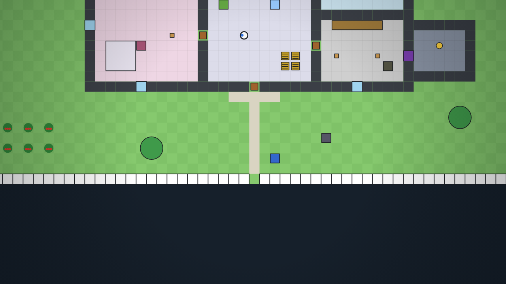
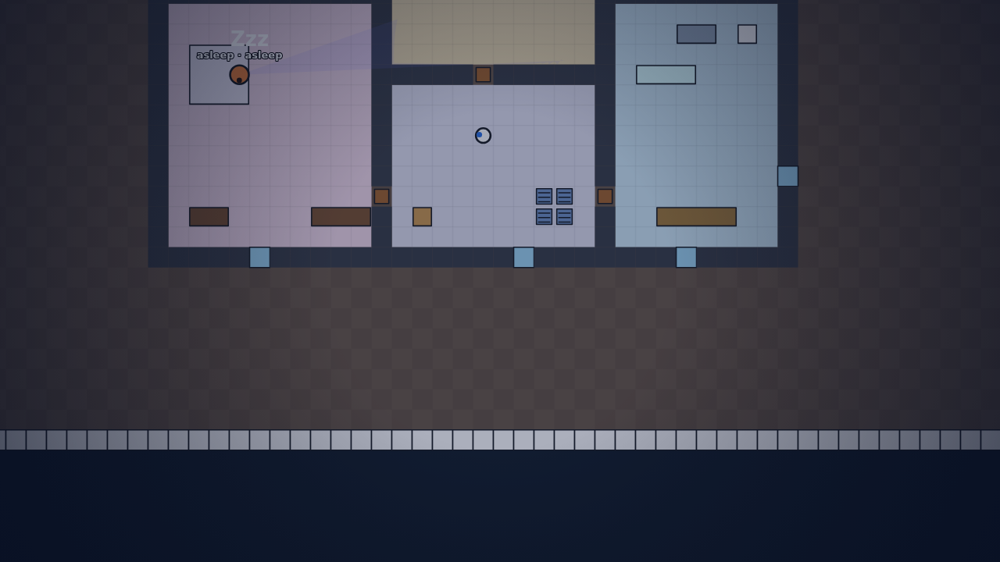

# Hello Neighbour 2D 🔦

A single-file browser stealth game. One hand-built house, two floors, and a
neighbour who **learns how you play**.

Everything is in **[`index.html`](index.html)** — no build step, no dependencies,
no external assets, no network. Open the file and press **PLAY**.

## Screenshots

| Ground floor | Upstairs |
| --- | --- |
|  |  |



## How to play

| Input | Action |
| --- | --- |
| **WASD / arrows** | Move |
| **Shift** | Sprint — fast, loud |
| **C** | Crouch — slow, quiet, harder to see |
| **E** | Use: search a container, pick a lock, take the stairs, hide in a wardrobe |
| **Click / F** | Throw the held object |
| **Q** | Drop the held object |
| **1–4** | Inventory slot |
| **H** | His belief map |
| **P** | His path |
| **Esc** | Pause |

**The route.** Take the **lockpick** from the shed → get inside the house → pick
the lock on the **upstairs office** and take the **blue key** from the desk →
take the **red key** from the kitchen fridge → unlock the basement door in the
workshop → take the SECRET.

The front door, the windows and the upstairs route are all real ways in.
Breaking a window is loud, he will notice, and on a later attempt he will board
it and set a trap on the floor you landed on.

## The house

One fixed map, 56×40 tiles per floor, the same every match.

- **Ground floor:** porch and path, living room, kitchen, dining room, foyer,
  bedroom, study (locked), bathroom, workshop, the vault behind its locked
  basement door, and the shed in the west yard.
- **Upstairs:** landing (stairs), upstairs hall, nursery, master bedroom, guest
  bedroom, upstairs bath and the **home office** where the blue key lives.

The two floors share the stairwell footprint in the foyer, so a stair tile simply
swaps the floor under you. No procedural generation, no variants.

## Keys are a keyring

The lockpick, the red key and the blue key live on the **keyring** in the HUD.
They are never inventory items, never in a slot, never dropped and never thrown.
The four slots of the bag are for tomatoes and other throwables.

## Night

The clock runs 6 in-game minutes per real second (a full day in four minutes), starting at 18:00. From
**21:00 to 06:00** the house is dark: the screen goes blue, and his sight range
drops to about half. He goes to bed at night, and a sleeping man only wakes for
something genuinely loud. That is your window — but the floorboards still creak.

## The neighbour

He is a small simulation, not a scripted chase.

### Perception

- **A real view cone** with occlusion: walls, closed doors and furniture stop
  sight. Sight never crosses a floor.
- **Corner-safe line of sight** — he cannot see you round a wall corner.
- **Hearing** through geometry: noise is attenuated per wall crossed and is
  almost mute between floors. Crouching is quiet, sprinting is not.
- **Night** halves his range. He goes to bed, and a sleeping man only wakes for
  something loud.

### The belief map

A normalised probability over **both floors** (`bel`, two layers of 56×40). It is
seeded from the last sighting plus the player's velocity, the objective, the rooms
and windows you have used, your route heat and the hiding places he has caught you
in before. It diffuses along walkable tiles, loses mass where he has just looked,
and leaks through the stairwell in both directions.

It drives the chase directly: while he can see you his target is you; the moment
sight or line of sight breaks, his target becomes the belief map's best reachable
spot — never your true position. Press **H** to watch it.

### The chase

- **One target, held.** He re-picks a chase target at most every 0.28 s, and only
  when the new spot is more than 1.6 tiles from the old one.
- **Direct or pathing, with hysteresis.** Close and clear he runs straight at you;
  past 7.6 tiles he drops back to pathing. He cannot flip between the two every
  frame, and only one steering routine sets his heading per frame.
- **Cut-offs.** While he can see you, he will look along your route to the thing
  you are after and take a point that is nearer to him than to you. Same floor
  only.
- **Stairs.** He uses the same staircase you do, and steps off it after a swap so
  he cannot ping-pong between floors.
- **No wallhacks.** Sight, acquisition and the catch all go through the same
  occlusion test. He cannot grab you through a wall, and a hidden player is never
  caught by proximity — he has to open the wardrobe.
- **No freezing.** Blocked movement drops the path and re-plans; repeated failure
  unsticks him.

### What he learns

Everything lives in `localStorage` under `hm2d.v1` and is per campaign:

- **Windows you climb through** — boarded up, and after two entries a trap is
  planned on a legal cell near the window.
- **Thefts** — search a container and he may notice it was searched; that raises
  suspicion and gets the room watched.
- **Your hours** — a histogram of when he has actually spotted you.
- **Your rooms and routes** — per-floor 4×4 route heat, used for patrol choices
  and belief priors.
- **Hiding places** — when he catches you in one it goes on his list, and the next
  search starts there.
- **Catches** — after two, a camera; after three, a new front-door lock.

### Traps and cameras go on legal ground

A trap is only set on open floor with body clearance, at least three ways past,
away from doors, stairs, windows, hiding places, other traps and your spawn, on a
floor he can actually reach. Invalid plans are dropped, and the script retries
nearby before giving up. Cameras go on reachable indoor floor against a wall, out
of the way of doorways.

## Match flow

**Menu → PLAY → a three-slide cutscene → the match.** Skip is always available.

- **Caught** shows what he learned, then **TRY AGAIN** restarts the same house
  with his memory intact.
- **NEW GAME — HE FORGETS** wipes the save and his memory completely.
- Every round rebuilds the world from the immutable base map: containers are
  restocked, doors re-locked, windows repaired, the vault resealed. Nothing from
  the last attempt leaks into the new one — only what he remembers.

## Tests

```bash
node test/game.js                # 118 checks
node legacy-3d/test/smoke.js     # 25 checks
```

`test/game.js` boots the real `index.html` in a dependency-free DOM/canvas stub
(`test/harness.js`) and drives it headlessly. It covers the two floors and the
stairwell, the keyring (never in the inventory), lock and vault gating, trap
validity and the plans generated from window use, night and sleep, the cutscene
and menu flow, catching, memory persistence across a reload, New Game wiping it,
world state not leaking between rounds, hiding and remembered hideouts, sight
occlusion (walls and floors), belief-driven chasing, chase cut-offs, heading
stability, no stalling, cross-floor pursuit, no catches through walls, and the
whole route being walkable.

## Repository layout

```
index.html            the entire game: map, AI, renderer, HUD, screens
test/game.js          118-check headless regression suite
test/harness.js       dependency-free DOM/canvas stub + seeded RNG
docs/                 screenshots
legacy-3d/            archived Three.js build (own 25-check suite)
README.md             this file
LICENSE               MIT
```

Run `node test/game.js` and `node legacy-3d/test/smoke.js`. There is no
`package.json`, no install step and no network access.

## Design notes

- 56×40 tiles, two floors; `FG[z][y][x]` lives, `BASE[z]` is immutable.
- A* (8-way, octile, no corner cutting, clearance costs) plus string pulling,
  always on a named floor.
- Belief is `Float32Array(2 × 56 × 40)`; diffusion runs on both floors with a
  stairwell transfer.
- Perception, pathing, traps, cameras and items all carry a floor; nothing
  implicit.
- Inspiration: the *Hello Neighbor* alpha AI (built around the house, cut-off
  predictions, traps on routes you used). This build keeps sight honest (no
  wallhacks), adds a second floor, and keeps the learning deterministic and
  inspectable instead of scripted.

A fan-made stealth-game homage, built from scratch. Not affiliated with, endorsed
by, or using assets from any commercial game.

## License

MIT — see [LICENSE](LICENSE).
