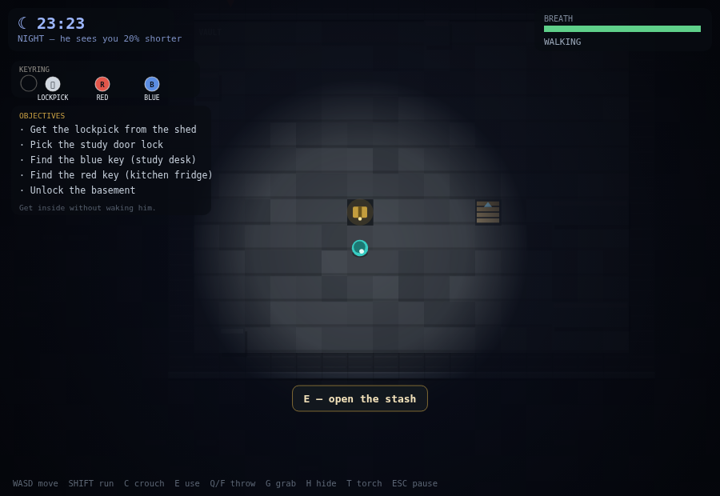
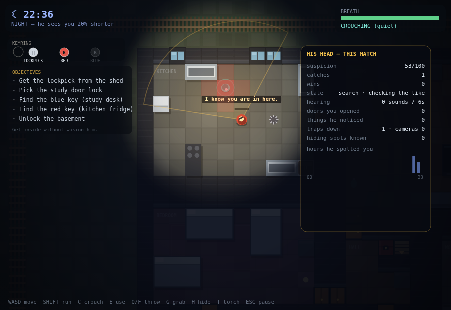

# Hello Neighbour 2D 🔦

A single-file browser stealth game. Break into a procedurally generated house,
out-think a neighbour who **learns how you play**, and take what is locked in his
basement.

Everything lives in **[`index.html`](index.html)** — no build step, no
dependencies, no external assets, no network. Open the file, press **Play**.


## What is in this build

| System | What it actually does |
| --- | --- |
| **Procedural house** | BSP rooms per floor, a union-find spanning tree of doorways plus extra loop doors, a study that is a true dead end, a cellar nook cut into a corner, windows that are guaranteed to have floor behind them, furniture that can never seal a room. Every seed is validated for solvability before it is accepted. |
| **Three floors** | Ground, upper and basement, joined by two stairways. The neighbour uses the stairs too. |
| **Keyring, not pockets** | The lockpick, the red key and the blue key live on a HUD keyring. They are never items, never in the bag, never throwable. |
| **Day / night** | The clock runs 42 real seconds per in-game hour. At night his sight drops 20%, the house is dark, lit rooms pool warm light. Crouching at night is nearly invisible; sprinting is not. |
| **A neighbour who learns** | Footstep triangulation, belief-map searches, chokepoint ambushes, door cut-offs, tomato forensics, theft detection, re-locking, boarding, traps, cameras. Details below. |
| **Match-scoped memory** | Everything he learns belongs to one match. Continue keeps it, New Game wipes it. |


*Night. Crouched in the doorway of the kitchen while he cooks. The cone is his
actual field of view — not decoration.*

## How to play

| Input | Action |
| --- | --- |
| **WASD / arrows** | Move |
| **Shift** | Sprint — fast, loud, and visible |
| **C** | Crouch — slow, silent, hard to see |
| **E** | Use: search, open, pick locks, take stairs, climb windows, open the stash |
| **G** | Grab / set down a loose object |
| **Q** / **F** / **left-click** | Throw ahead / throw at the cursor |
| **H** | Hide (dark corners only) |
| **T** | Torch — light, but he sees you further |
| **M** | His belief map |
| **Shift+wheel** | Zoom |
| **Esc / P** | Pause, with the panel of everything he knows |

**The route.** Get the **lockpick** from the shed → inside the house → pick the
**study** door upstairs → take the **blue key** from the desk → take the **red
key** from the kitchen fridge → unlock the **basement** door → take what is in
the stash.

The front door, the windows and the cellar are all real routes. Breaking a window
is loud; he will notice and board it up on a later attempt.

## The neighbour

He is a small, honest simulation rather than a scripted chase.



*Three floors down: the vault, the stash, and the only reason to be here.*

### What he perceives

- **A real view cone** with occlusion: walls, closed doors and furniture block
  sight. No wallhacks — the cone you see on screen is the cone he uses.
- **Stale sightings.** Alertness rises while he looks at you and decays when he
  does not; a glimpse in the dark does not instantly become a chase.
- **Hearing through geometry.** Noise radius is attenuated per wall crossed and
  almost mute between floors. Footsteps are quiet when crouched, loud when
  sprinting.
- **A rolling six-second noise buffer.** Three or more noises inside six seconds
  give him a direction *and* a speed, so he walks to the **predicted** position
  instead of the last one. "Following the sound…"
- **Night realism.** Sight range ×0.8 at night, ×1.5 with your torch on, ×1.15
  when you sprint, ×0.55 when you crouch, and a lit room helps him spot you.
- **Cameras**, once he has caught you twice, sweep a cone and radio him.

### What he does about it

- **Quiet approach.** A sighting further than 7.5 tiles becomes a slow,
  close-the-distance approach; the chase only starts when he is sure.
- **Door cut-offs.** If you break line of sight in the open he runs for a doorway
  on your route to the objective — but only if he can actually beat you there
  (`distance / 3.8 < your distance / 3.5`). "Cutting you off at the door!"
- **Belief-map search.** Losing you seeds a per-floor probability map from your
  last position, your velocity, your likely objective, the places you have hidden
  before, minus the places he has just cleared. He sweeps the peaks.
- **Chokepoint ambushes.** Every third search step he camps the nearest doorway
  and faces the approach instead of wandering.
- **Tomato forensics.** A thrown object that hits him records its origin; he
  wipes his face and hunts from where it came.
- **Traps**, placed only on walkable floor that is not a doorway, a stair, a
  window, furniture, a container's approach, his own tile or your feet — and
  never somewhere that could disconnect a room.
- **House-keeping.** He re-locks doors you picked, boards windows you broke and
  puts moved objects back where they belong.

### What he remembers



*Press **M** during play: the red wash is his belief about where you are, the
dashed line is his route.*

All of it is per match and visible in the pause panel:

- **Suspicion** — a slow meter fed by noises, broken glass, sightings and thefts,
  decaying over time, driving how often he patrols, guards the basement and
  checks his valuables.
- **Your hours** — a histogram of when he has actually spotted you. Those hours
  get patrols and a guard on the basement door.
- **Your routes** — how often you walk each tile; that is where traps go.
- **Your entries** — doors and windows you use; after two catches that is where
  the camera goes.
- **Thefts** — he only notices an emptied container or a missing ornament when he
  can actually see it. "Someone has been in my fridge!" costs you 14 suspicion
  and gets the container watched.
- **Hiding places** — where he has caught you seeds the next search.
- **The lighter sleeper** — after the first catch, less noise wakes him.

**Caught?** The match restarts in the same house with everything he learned
intact. **New Game** erases all of it, including traps, cameras and boarded
windows.

## Procedural generation

Every match has its own seed and its own house. A floor is a BSP tree; leaves
become rooms; doorways are carved along a **union-find spanning tree of shared
walls** so the floor is always connected, then ~22% extra doors are added to
create loops and shortcuts. Windows are fitted last, from the outside in, so one
can never end up with a wall behind it. The basement is a fixed shell with a
stair and a vault; the cellar door is cut into a room corner with two sealing
walls so it cannot become a corridor.

Then `validateWorld` proves the seed is fair before the game accepts it:

- every room reachable with everything unlocked;
- the toolbox and the red key reachable with no keys;
- the desk reachable only with the lockpick;
- the study genuinely locked, the basement genuinely locked;
- the basement secret unreachable without the red key and reachable with it;
- stair tiles `U`/`N` on both ends, doors never on stairs, furniture always solid;
- containers solid, standable from at least one adjacent tile;
- every window has interior floor behind it.

The game tries seeds until one passes; in practice ~88% of raw seeds are valid
and a build takes ~1.2 attempts. A 900-line headless suite generates forty of them
and checks the invariants.

## Tests

```bash
node test/game2d.js     # 350 checks
```

The suite boots the real `index.html` in a stub DOM/canvas and drives it with
simulated key presses. It covers the generator contract (including forty
generated worlds), a full keyboard-only run from the shed to the stash across
three floors, keyring-vs-inventory, night senses, sight and occlusion, the noise
buffer, the chase and the catch, belief-map search, ambushes, trap validity, theft
detection and re-locking, camera placement gating, tomato forensics, match-scoped
memory (continue keeps it, New Game wipes it), and every screen rendering.

The archived Three.js build is in [`legacy-3d/`](legacy-3d/) with its own
25-check suite (`node legacy-3d/test/smoke.js`).

## Repository layout

```
index.html            the entire game: generator, AI, renderer, HUD
docs/                 screenshots used by this README
test/game2d.js        350-check headless regression suite
test/harness.js       dependency-free DOM/canvas stub + seeded RNG
legacy-3d/            archived v1.3 Three.js build
.dev/                 generator + runtime sources and the assembler (git-ignored)
README.md             this file
LICENSE               MIT
```

`index.html` is generated from `.dev/*.js` by `node .dev/build.js`. The shipped
file is self-contained; the split exists only to keep the source reviewable.

## Design notes

- **World:** 48×36 tiles, three floors, `w.floors[z].G[y][x]`; the house is
  28×25 and the basement 19×15.
- **Navigation:** 8-way A* with no corner cutting, floor-aware hand-off through
  stair tiles, door opening as part of the path, wall attenuation for sound.
- **AI:** perception → belief → utility scripts (`routine`, `suspicious`,
  `search`, `chase`, `ambush`, `fortify`), all driven by the match memory.
- **Inspiration:** the *Hello Neighbor* alpha AI (designed around the house,
  cut-off predictions, seeing through walls while chasing) and the published
  interviews about an AI that reasons from sound, notices changed objects and
  sets traps on the routes you used. This build deliberately keeps sight honest
  (no wallhacks), adds floors, and makes the learning deterministic and per-match
  rather than a black box.

A fan-made stealth-game homage built from scratch. Not affiliated with, endorsed
by, or using assets from any commercial game.

## License

MIT — see [LICENSE](LICENSE).
